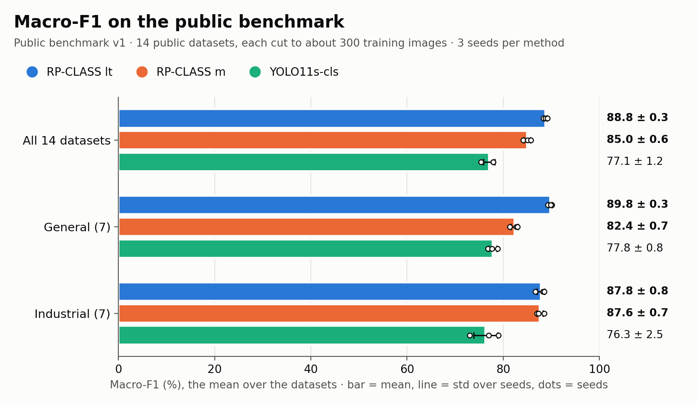
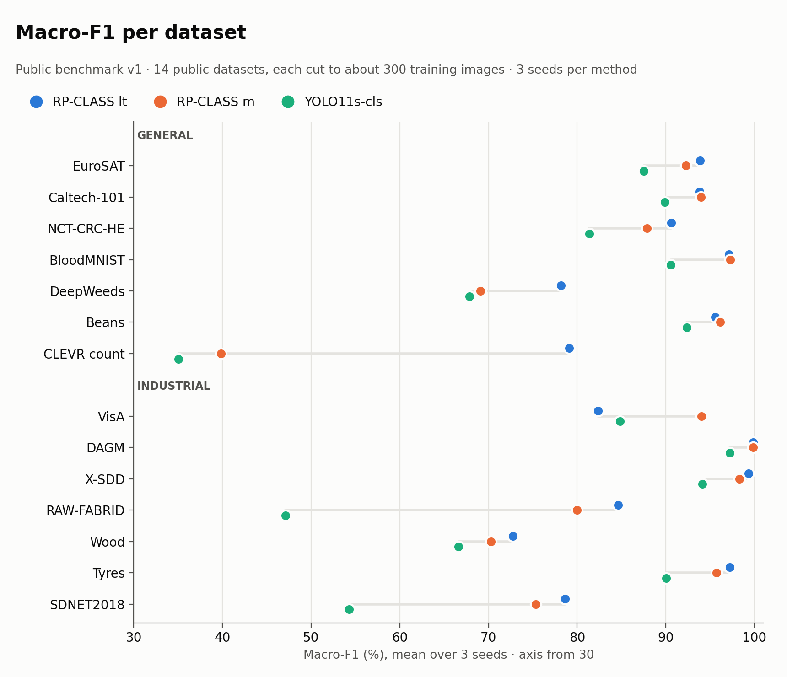

# RP-CLASS

Image classification for industrial vision. One object, `RPCLASS`, with a few sizes and one fixed recipe, trained
for a number of epochs or to a time budget, and exported to ONNX for serving (TensorRT, ONNX Runtime, Triton). It is
built the same way as RP-OD, its object-detection sibling.

> **Version 0.1.0**, the first public release; the API can still change before 1.0. The design decisions:
> `docs/DESIGN.md`. Every experiment and its numbers: `docs/EXPERIMENTS.md`.

## Install

Python 3.10 or newer, PyTorch 2.5 or newer.

```bash
pip install "rpclass[export] @ git+https://github.com/rosepetal-ai/rosepetal-research-RP-CLASS@v0.1.0"
```

`[export]` adds ONNX and ONNX Runtime, which `model.export()` needs.

## Use

```python
from rpclass import RPCLASS

model = RPCLASS('s')                              # CNNs 's', 'm' (default), 'l'; transformer 'lt'
res = model.train('parts')                        # a folder: train/<class>/..., val/<class>/..., test/<class>/...
res['val'].macro_f1, res['val'].top1              # final metrics of the best epoch
r = model.predict(image, color='BGR')[0]          # numpy uint8 array + color tag, a file, a folder or a list
r.name, r.conf, r.probs                           # conf: at most 0.95 for 2 classes (label smoothing 0.1)
model.export()                                    # model.onnx + config.json (contract in rpclass/engine/exporter.py)
```

`train` augments with the 8 orientations of the image (flips and 90-degree turns) by default; give it
`keep_orientation=True` when the orientation is the class (a part upside down, a mirrored label). Each size has its
default input size (384 px, 448 for `lt`). It also trains to a time budget (`time=` seconds, `reserve=`, `patience=`
an int, None or a function), as RP-OD does. Runs go to `runs/train/<name>/`: `weights/best.pt`, `weights/last.pt`,
`results.csv`, `args.yaml`, and `val/` and `test/` with `metrics.json`, `confusion_matrix.png` and `predictions.jpg`
(the most confident mistakes first).

## Pretrained weights

Sizes `s`, `m` and `l` start from HGNetv2 weights (PaddleClas, Apache-2.0); size `lt` from Meta's DINOv3 ViT-S/16
weights (LVD-1689M), under the [DINOv3 License](https://ai.meta.com/resources/models-and-libraries/dinov3-license/),
not under RP-CLASS's licence. timm downloads them when a model is first built. Using `lt` means accepting the DINOv3
License, including its end-use restrictions, and a model trained from `lt` carries its terms. Details:
`THIRD_PARTY.md`.

## Status

| Part | State |
|---|---|
| Repository, licence, CI (tests, secret scan) | done |
| Library: data, training (epochs or time budget), metrics, predict, export | done |
| Backbone, sizes and recipe, chosen from measurements | done: sizes, augmentation, input size, learning rate and label smoothing (docs/DESIGN.md, As built) |
| Benchmark | done: public benchmark version 1 (below); the recipe was tuned on three private OK / NOK inspection sets |
| Serving (TensorRT float16 behind Triton, letterbox on the GPU) | done: the same answers as `predict()`, m in 0.7 ms and lt in 1.4 ms per image (docs/EXPERIMENTS.md, 2026-11-09) |

## Public benchmark

14 public datasets (7 general, 7 industrial), each cut to about 300 training images, the size of a typical inspection
dataset, with 3 seeds per method (`docs/BENCHMARK.md`, results in `benchmarks/public/results/v1`). Each method trains
with its own default recipe. Macro-F1, the mean over the datasets:



| method | all 14 | general | industrial |
|---|---|---|---|
| RP-CLASS lt (DINOv3 ViT-S/16) | 88.8 ± 0.3 | 89.8 ± 0.3 | 87.8 ± 0.8 |
| RP-CLASS m (HGNetv2-B2) | 85.0 ± 0.6 | 82.4 ± 0.7 | 87.6 ± 0.7 |
| YOLO11s-cls | 77.1 ± 1.2 | 77.8 ± 0.8 | 76.3 ± 2.5 |

On every dataset, `m` is ahead of YOLO11s-cls, and `lt` is ahead on all but VisA. `lt` leads most on CLEVR count,
which needs the whole scene. On the industrial sets the two sizes tie on average: `m` is ahead on VisA, `lt` on five of
the other six, and DAGM is a tie (99.8). The numbers per dataset are in `docs/BENCHMARK.md`.



`python3 benchmarks/public/plots.py` draws both charts from `benchmarks/public/results/v1/scores.csv`.

## Inference time

TensorRT 10.9, batch 1, float16 / float32 (GPU time per image, median of 1000 runs, without host-device copies):

| Model | Input | RTX 4090 | RTX 3060 | RTX 2060 |
|---|---|---|---|---|
| **RP-CLASS `s`** (HGNetv2-B0) | 384 × 384 | 0.22 / 0.35 ms | 0.43 / 0.84 ms | 0.50 / 1.13 ms |
| **RP-CLASS `m`** (HGNetv2-B2) | 384 × 384 | 0.34 / 0.59 ms | 0.80 / 1.68 ms | 1.02 / 2.48 ms |
| **RP-CLASS `l`** (HGNetv2-B4) | 384 × 384 | 0.44 / 0.75 ms | 1.20 / 2.52 ms | 1.57 / 4.27 ms |
| **RP-CLASS `lt`** (DINOv3 ViT-S/16) | 448 × 448 | 0.91 / 1.90 ms | 2.77 / 8.38 ms | 3.72 / 14.29 ms |
| YOLO11s-cls | 224 × 224 | 0.23 / 0.41 ms | 0.35 / 0.73 ms | 0.49 / 0.97 ms |
| YOLO11s-cls | 384 × 384 | 0.26 / 0.48 ms | 0.53 / 1.21 ms | 0.67 / 1.84 ms |

Each RP-CLASS size runs at its default input size; YOLO11s-cls at its own default (224) and at 384. On all three GPUs,
the float16 engines give PyTorch's class, with probabilities within 5e-4. Float32 uses TF32 where the GPU has it (RTX
4090 and 3060). How it was measured: `benchmarks/tensorrt.py sizes`, then trtexec as its docstring says, then
`benchmarks/tensorrt.py report` (docs/EXPERIMENTS.md, 2026-11-10).

## Development

```bash
git clone https://github.com/rosepetal-ai/rosepetal-research-RP-CLASS && cd rosepetal-research-RP-CLASS
pip install -e ".[dev]"
./setup-hooks.sh                # gitleaks on every commit, the same scan the CI runs
python3 -m pytest tests -q
```

Outside pull requests are not accepted for now; issues are welcome (`CONTRIBUTING.md`).

## Acknowledgements

RP-CLASS `lt` is built with DINOv3 (Siméoni et al., DINOv3, arXiv:2508.10104, 2025). The CNN sizes use HGNetv2
weights from PaddleClas, loaded with timm. The YOLO11s-cls baseline is by Ultralytics (AGPL-3.0). The benchmark's
datasets and their authors: `docs/DATASETS.md`.

## License

RP-CLASS is available under a dual licensing model:

- **Open Source License:** [GNU AGPLv3](LICENSE).
- **Commercial License:** the Rosepetal Enterprise License, available upon request for organizations requiring
  alternative licensing terms.

For commercial licensing inquiries, please contact licensing@rosepetal.ai.

Copyright (C) 2026 Rosepetal AI.
