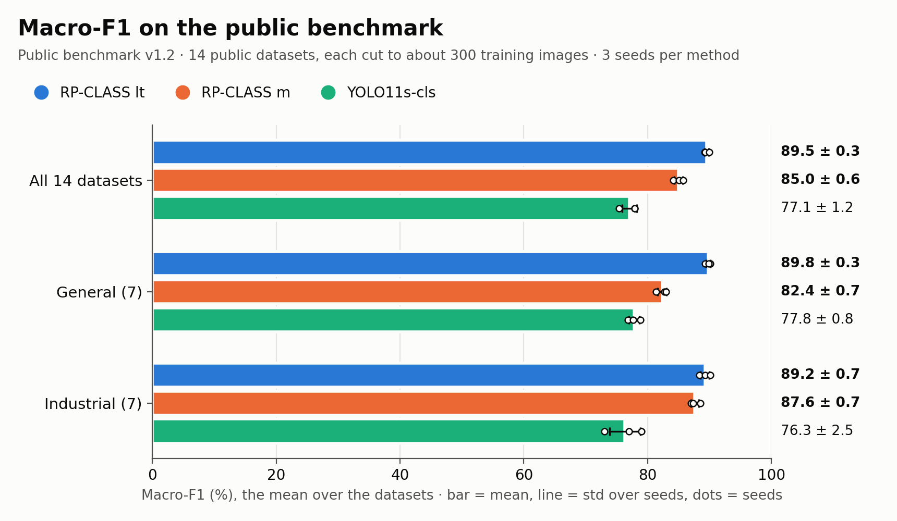
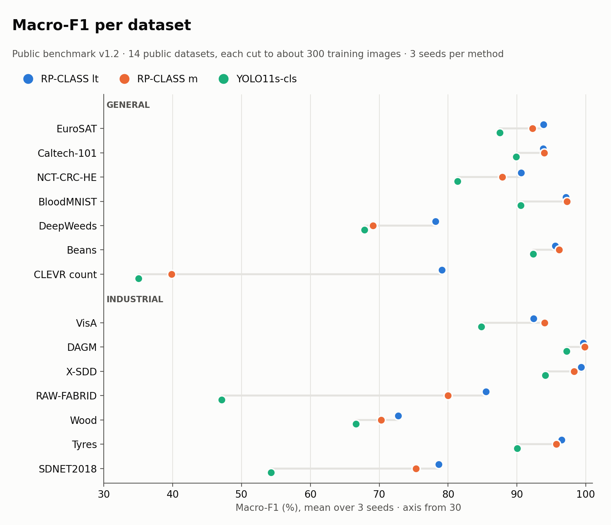

# RP-CLASS - Image Classification for Industrial Vision

RP-CLASS (the Python package `rpclass`) is an image classifier for industrial vision: one object, `RPCLASS`, with four sizes and one fixed recipe, trained for a number of epochs or to a time budget and exported to ONNX for serving (TensorRT, ONNX Runtime, Triton). It is built the same way as [RP-OD](https://docs.rosepetal.ai/research/rp-od), its object-detection sibling.

```python
from rpclass import RPCLASS

model = RPCLASS('s')                              # CNNs 's', 'm' (default), 'l'; transformer 'lt'
res = model.train('parts')                        # a folder: train/<class>/..., val/<class>/..., test/<class>/...
res['val'].macro_f1, res['val'].top1              # final metrics of the best epoch
r = model.predict(image, color='BGR')[0]          # numpy uint8 array + color tag, a file, a folder or a list
r.name, r.conf, r.probs
model.export()                                    # model.onnx + config.json
```

The version described here is 0.1.2. The API can still change before 1.0.

## Installation

The package is installed from the GitHub repository, at a release tag:

```bash
pip install "rpclass[export] @ git+https://github.com/rosepetal-ai/rosepetal-research-RP-CLASS@v0.1.2"
```

For development:

```bash
git clone https://github.com/rosepetal-ai/rosepetal-research-RP-CLASS && cd rosepetal-research-RP-CLASS
pip install -e ".[dev]"
./setup-hooks.sh                # gitleaks on every commit, the same scan the CI runs
python3 -m pytest tests -q
```

## Requirements

- Python 3.10 or newer.
- PyTorch 2.5 or newer, torchvision 0.20 or newer, timm 1.0.20 or newer, NumPy, PyYAML, Pillow and Matplotlib, installed with the package (`pyproject.toml`).
- The `export` extra installs `onnx` and `onnxruntime`: the export writes the TensorRT batch range into the model with `onnx`, and the optional checks run with `onnxruntime`.
- A CUDA GPU is used when PyTorch sees one, otherwise the CPU. On a GPU, training runs in mixed precision (bfloat16 where the card supports it natively, float16 otherwise); validation always runs in float32.
- Internet access the first time a model of a size is built: timm downloads its pretrained weights from Hugging Face.

## Documentation

| Page | Content |
|---|---|
| [RP-CLASS](./index.md) | This page: sizes, datasets, training, validation, prediction, export and the reported results |
| [Design](./DESIGN.md) | The design decisions and how each one was built |
| [Public Benchmark](./BENCHMARK.md) | The protocol of the public benchmark and its results |
| [Datasets](./DATASETS.md) | The datasets of the benchmark and of the development suite: creators, sources and licences |
| [Experiments](./EXPERIMENTS.md) | Every experiment behind a decision, with its setup and numbers, newest first |

## Model Sizes

Two ranges: three CNN sizes on RP-OD's HGNetv2 backbones, and a transformer size on a DINOv3 ViT. Each size is a timm network with pretrained weights whose classification head is replaced by one for the dataset's classes.

| Size | Backbone | Pretrained weights (timm tag) | Default input | Parameters |
|---|---|---|---|---|
| `s` | HGNetv2-B0 | `hgnetv2_b0.ssld_stage1_in22k_in1k` (ImageNet) | 384 × 384 | 3.9 M |
| `m` | HGNetv2-B2 | `hgnetv2_b2.ssld_stage1_in22k_in1k` (ImageNet) | 384 × 384 | 9.2 M |
| `l` | HGNetv2-B4 | `hgnetv2_b4.ssld_stage1_in22k_in1k` (ImageNet) | 384 × 384 | 17.8 M |
| `lt` | DINOv3 ViT-S/16 | `vit_small_patch16_dinov3.lvd1689m` (LVD-1689M) | 448 × 448 | 21.6 M |

The parameters are those measured in the backbone benchmark on two-class datasets ([Experiments](./EXPERIMENTS.md), 2026-11-06). The default input sizes come from the image-size experiment: HGNetv2-B2 peaks at 384 px and the ViT still gains at 448. A trained model predicts and is exported at the size it was trained at. `model.info(imgsz=...)` prints the parameters of the backbone and the head and the GFLOPs.

The `lt` weights are under Meta's [DINOv3 License](https://ai.meta.com/resources/models-and-libraries/dinov3-license/), not under the RP-CLASS license: using `lt` means accepting it, including its end-use restrictions, and a model trained from `lt` carries its terms. The HGNetv2 weights are PaddleClas's, under Apache-2.0. None of these weights are distributed with RP-CLASS (see [THIRD_PARTY.md](https://github.com/rosepetal-ai/rosepetal-research-RP-CLASS/blob/main/THIRD_PARTY.md)).

## Datasets

A dataset is a folder with one subfolder per class in each split:

```
parts/
  train/<class>/<image>     required
  val/<class>/<image>       required, not empty ('validation/' or 'valid/' are accepted too)
  test/<class>/<image>      optional, only ever used for a final evaluation
```

- The classes are the class folders found in any split, and their ids follow the sorted names. At least two classes; empty class folders are fine. Images may sit in subfolders of their class folder.
- Images: `.jpg`, `.jpeg`, `.png`, `.bmp`, `.tif`, `.tiff`, `.webp`, 8-bit.

Every image is decoded once before training, and the result is cached (in `~/.cache/rpclass/datasets`, moved by `RPCLASS_CACHE`) until a file changes:

- **Errors** stop training and are listed with the file and the reason: a missing `train` or `val` folder, or one without images; fewer than two class folders; an image outside any class folder; an unreadable or truncated image; an image that is not 8-bit or too large to decode.
- **Warnings** are printed and training goes on: no test images (validation metrics are then optimistic, because validation picks the best epoch), a class without training images, identical images in two splits or inside one, and top-level folders other than the splits, which are ignored.

```python
from rpclass.data import check_dataset
ds = check_dataset('parts')      # raises listing the errors (the first 50, then how many more); returns the records, stats and warnings
```

## Training

```python
model = RPCLASS('m')
res = model.train('parts', epochs=100, patience=20, batch=32)
res['val'].macro_f1, res['test']                  # final metrics of the best epoch on val and test (or None)
model.predict('images/')                          # the object is now the best model
```

| Argument | Default | Meaning |
|---|---|---|
| `data` | (required) | The dataset folder |
| `imgsz` | `None` | An int or `[height, width]`, each rounded up to a multiple of 32; the image is letterboxed into it, here and in production. `None`: the size the model was trained at, else the size's default (384, or 448 for `lt`) |
| `epochs` | `100` | Epochs to train. With `time`, the most it may train |
| `patience` | `20` | Epochs without a higher validation macro-F1 before the final decay starts early (from the best epoch's weights); `None` never; or a function of the planned epochs |
| `batch` | `32` | Effective batch. If it does not fit in the GPU it is split into accumulation steps, shown in the log |
| `device` | `cuda` if available, else `cpu` | Device to train on |
| `augment` | the default augmentation | `None` for no augmentation, or your own function `augment(sample, ctx)` |
| `keep_orientation` | `None` | `True` when the orientation is part of the class: no flips or turns. `None`: what the checkpoint was trained with, else `False` |
| `pretrained` | `True` | A new model starts from the pretrained weights of its backbone; `False`: random weights |
| `time` | `None` | Seconds for the whole call, setup and final evaluation included: train to a time budget instead of a number of epochs |
| `reserve` | `None` | Seconds of `time` kept for the caller after training, or a function of the measured stats |
| `final_eval` | `True` | `False` skips the final evaluation of the best weights on val and test (`val` and `test` come back `None`) |
| `name`, `project` | `'exp'`, `'runs/train'` | The run goes to `project/name`, with a number added if the folder exists |
| `workers` | `None` | Dataloader workers: the `RPCLASS_WORKERS` environment variable, else the number of CPUs up to 8 |

`train` returns a dict with `dir` (the run folder), `best_epoch`, `val` and `test` (metrics), `planned_epochs`, `stop_reason` (`'EPOCHS_COMPLETED'`, `'EARLY_STOPPED'` or `'TIME_BUDGET_REACHED'`) and `budget_overrun_s` (with `time`: seconds past the budget, negative when time was left). A model loaded from a checkpoint trains from its weights; with another number of classes, only the head starts fresh.

### Training Recipe

Everything else is fixed, chosen from the measurements in [Experiments](./EXPERIMENTS.md):

| Part | Choice |
|---|---|
| Optimizer | AdamW: the new head at learning rate 1e-3, the pretrained backbone at 1e-4; weight decay 0.05 (none on biases, norms, position embeddings and class tokens) |
| Loss | Cross-entropy with label smoothing 0.1: the target of the right class is 1 - 0.1 + 0.1 / C, 0.95 for two classes |
| Schedule | Warmup (2,000 steps, or 5 % of the steps when that is fewer), flat, then a cosine decay to 5 % of the learning rate over the last 20 % of the epochs. `patience` epochs without a higher macro-F1 start that decay early, from the weights of the best epoch |
| Stability | EMA of the weights (what is validated and saved), gradient clipping at 1.0; BatchNorm frozen when fewer than 8 images fit in one step |
| Best epoch | Highest validation macro-F1; on equal macro-F1, the lower validation loss; on an exact tie, the later epoch. Top-1 accuracy is logged too |
| Last epochs | The last 4 % of the epochs (at least one) start again from the weights of the best epoch, and the default augmentation leaves their images as they are |
| `lt` head start | If validation still scores what answering one class scores (within 0.02) at the first validation after the warmup, from the third epoch, the run starts over once from the pretrained weights, its head the linear probe of the pretrained features of the training images, scaled by 0.1. The CNN sizes keep timm's head |

### Augmentation

By default each training image gets, before the letterbox:

- photometric distortion (brightness, contrast, saturation and hue) with probability 0.5;
- the 8 orientations of the square: a horizontal flip 0.5, a vertical flip 0.5 and a turn by a random multiple of 90 degrees.

The last 4 % of the epochs use images without augmentation. Nothing that erases or invents content is ever applied (no random erasing, mixup or cutmix): in inspection that can remove the defect or create one. On two private inspection sets the 8 orientations gained 1.3 to 3.6 points of macro-F1, and they changed nothing on natural photos ([Experiments](./EXPERIMENTS.md), 2026-11-06).

`keep_orientation=True` removes every flip and turn, for a task whose class is the orientation (a part mounted upside down, a mirrored label); a checkpoint keeps the setting, and training it again inherits it. `augment=None` trains without augmentation. Your own function receives each training sample and returns it, at any size:

```python
def augment(sample, ctx):
    # sample.image uint8 RGB [H, W, 3]; sample.label (must not change); sample.path
    # ctx.epoch (from 0); ctx.epochs (where training ends); ctx.imgsz; ctx.rng (numpy generator);
    # ctx.clean: with a time budget, whether this epoch is in the clean last stretch
    return sample
```

With your own function, `keep_orientation=True` is an error: the function decides its geometry itself.

### Training to a Time Budget

```python
res = model.train('parts', time=10 * 60, epochs=500)   # 10 min for the whole call; at most 500 epochs
res['planned_epochs'], res['stop_reason']
```

The final decay takes the last 20 % of the time and the clean images the last 4 %. After every epoch RP-CLASS measures what an epoch costs (augmented or clean, the mean of the last three of each) and plans the rest from the time left, the final evaluation included. Training stops between epochs, never inside one, and the last epoch is always a clean one from the best weights. `reserve=` keeps time for what the caller does afterwards; `patience=` can be a function of the planned epochs.

### Run Folder

```
runs/train/exp/
  weights/best.pt    weights/last.pt
  results.csv        one row per epoch, written as it goes
  args.yaml          the arguments and the recipe of the run
  val/   test/       metrics.json, confusion_matrix.png, predictions.jpg
```

`predictions.jpg` shows up to 16 images: the mistakes first, the most confident first, then the right answers, the least confident first. The test split, if there is one, is evaluated once at the end and never used for a decision.

## Validation

```python
model = RPCLASS('runs/train/exp/weights/best.pt')
m = model.val()                                   # val split of the training dataset -> runs/val/exp
m = model.val(data='other', split='test')         # another dataset: same class names, in any order
m.macro_f1, m.balanced_accuracy, m.top1, m.top5, m.loss, m.fitness
m.per_class, m.confusion_matrix                   # rows: true class, columns: predicted class
```

- Every image counts once, with the class of its highest score: there is no threshold.
- Macro-F1 and balanced accuracy are means over the classes that have images in the split, so every class weighs the same however few images it has; a class without images shows as `-`.
- `top5` is -1 with 5 classes or fewer. `loss` is the plain cross-entropy, without label smoothing.
- Images whose scores are not finite (a float16 overflow) count as wrong, with a warning.

## Prediction

```python
results = model.predict(image, color='BGR')     # a numpy uint8 array with its color tag, a file, a folder or a list
r = results[0]
r.top1, r.name, r.conf, r.probs                 # class id, class name, its probability, every probability
r.top(3)                                        # the 3 most probable classes as (class id, probability)
r.save('out.jpg')                               # the image with the predicted class written on it
```

`color` is `'RGB'` (default), `'BGR'` or `'GRAY'` for arrays; files are read as RGB. Only 8-bit images are accepted. `predict` letterboxes the image (aspect ratio kept, gray padding), which is the input the exported model expects too, and applies a softmax: the class is the most probable one.

## Export

```python
model.export()                  # runs/train/exp/weights/best_export/: model.onnx + config.json
model.export('deploy/parts')    # another folder
model.export(check=True)        # also compare ONNX Runtime with PyTorch and look for float16 overflows
```

By default the export goes to a folder named after the checkpoint (`best_export` next to `best.pt`). The ONNX model (opset 17):

| Role | Name | Shape | Content |
|---|---|---|---|
| Input | `images` | float32 `[B, 3, H, W]` | Letterboxed RGB images, values 0-1 (the normalization is inside the model); `B` is dynamic |
| Output | `logits` | float32 `[B, C]` | Class scores before the softmax, shifted so that the highest of each image is 0 |

- The batch range for TensorRT, 1 to 16 images at the trained size, is written into the model's metadata (`rosepetal.trt_profiles`).
- The scores are logits, not probabilities: a softmax gives the probabilities, and the class is the one at 0.
- A transformer's attention is exported with its keys centred over the tokens, which leaves the answer unchanged and makes the attention logits smaller: without it a float16 TensorRT engine of `lt` gave NaN for every image, with it the same engine gives the model's answers ([Experiments](./EXPERIMENTS.md), 2026-11-09).
- `config.json` holds the model name (`rpclass`), the task, the input shape, the maximum batch, the pre-processing (letterbox, padding 114, antialias, divide by 255) and the classes.
- `check=True` runs two checks after the export: the ONNX Runtime logits against PyTorch's, and a search for values inside the model that float16 cannot hold. Both only warn and keep the export. They are off by default because the float16 check holds every internal tensor of one image in memory (46 GB for `lt` at 1024 × 2048).

## Public Benchmark

14 public datasets (7 general, 7 industrial), each cut to about 300 training images, the size of a typical inspection dataset, with 3 seeds per method. Each method trains with its own default recipe. The protocol and every table are in [Public Benchmark](./BENCHMARK.md); the runs are in [`benchmarks/public/results/v1`](https://github.com/rosepetal-ai/rosepetal-research-RP-CLASS/tree/main/benchmarks/public/results/v1).

Version 1 (2026-11-09), macro-F1, the mean over the datasets (mean ± standard deviation over the seeds):



| Method | All 14 | General (7) | Industrial (7) |
|---|---|---|---|
| RP-CLASS `lt` (DINOv3 ViT-S/16) | 88.8 ± 0.3 | 89.8 ± 0.3 | 87.8 ± 0.8 |
| RP-CLASS `m` (HGNetv2-B2) | 85.0 ± 0.6 | 82.4 ± 0.7 | 87.6 ± 0.7 |
| YOLO11s-cls | 77.1 ± 1.2 | 77.8 ± 0.8 | 76.3 ± 2.5 |

On every dataset, `m` is ahead of YOLO11s-cls, and `lt` is ahead on all but VisA. `lt` leads most on CLEVR count, which needs the whole scene. On the industrial sets the two sizes tie on average: `m` is ahead on VisA, `lt` on five of the other six, and DAGM is a tie (99.8). In version 1, 5 of `lt`'s 36 VisA runs never left the majority class; RP-CLASS 0.1.2 starts such a run over (the `lt` head start above), and version 1's `lt` numbers predate it.



Both RP-CLASS sizes ran at 224 px on 11 of the 14 datasets, below their own defaults. These are one-time test numbers: nothing in the library was decided on them.

## Inference Time

TensorRT 10.9, batch 1, float16 / float32 (GPU time per image, median of 1000 runs, without host-device copies):

| Model | Input | RTX 4090 | RTX 3060 | RTX 2060 |
|---|---|---|---|---|
| **RP-CLASS `s`** (HGNetv2-B0) | 384 × 384 | 0.22 / 0.35 ms | 0.43 / 0.84 ms | 0.50 / 1.13 ms |
| **RP-CLASS `m`** (HGNetv2-B2) | 384 × 384 | 0.34 / 0.59 ms | 0.80 / 1.68 ms | 1.02 / 2.48 ms |
| **RP-CLASS `l`** (HGNetv2-B4) | 384 × 384 | 0.44 / 0.75 ms | 1.20 / 2.52 ms | 1.57 / 4.27 ms |
| **RP-CLASS `lt`** (DINOv3 ViT-S/16) | 448 × 448 | 0.91 / 1.90 ms | 2.77 / 8.38 ms | 3.72 / 14.29 ms |
| YOLO11s-cls | 224 × 224 | 0.23 / 0.41 ms | 0.35 / 0.73 ms | 0.49 / 0.97 ms |
| YOLO11s-cls | 384 × 384 | 0.26 / 0.48 ms | 0.53 / 1.21 ms | 0.67 / 1.84 ms |

Each RP-CLASS size runs at its default input size; YOLO11s-cls at its own default (224) and at 384. On all three GPUs the float16 engines give PyTorch's class, with probabilities within 5e-4. Float32 uses TF32 where the GPU has it (RTX 4090 and 3060). Served in a float16 engine behind NVIDIA Triton, with the letterbox on the GPU, a whole request took 0.72 ms for `m` and 1.38 ms for `lt` on the RTX 4090 (median round trip, one image at a time) ([Experiments](./EXPERIMENTS.md), 2026-11-09 and 2026-11-10).

## Contributing

Outside pull requests are not accepted for now; issues are welcome ([CONTRIBUTING.md](https://github.com/rosepetal-ai/rosepetal-research-RP-CLASS/blob/main/CONTRIBUTING.md)).

## License

RP-CLASS is available under a dual licensing model:

- **Open source**: the GNU Affero General Public License, version 3 only ([LICENSE](https://github.com/rosepetal-ai/rosepetal-research-RP-CLASS/blob/main/LICENSE)).
- **Commercial**: the Rosepetal Enterprise License, under a separate written agreement with Rosepetal AI. Contact licensing@rosepetal.ai.

The pretrained weights keep their own licences (see [Model Sizes](#model-sizes)). Copyright (C) 2026 Rosepetal AI.
